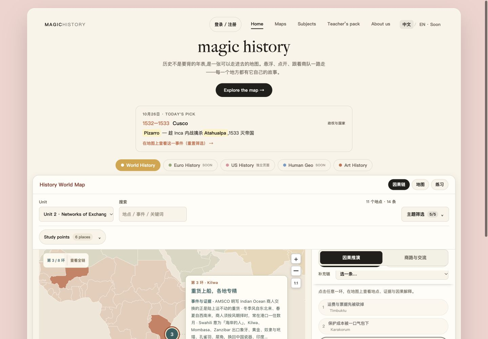

# 正式首页整合记录 — 2026-10-26

正式入口为根目录 `index.html`，世界史地图为 `world-map.html`。两者由 `python3 scripts/build-site.py` 从 `src/site/index.template.html` 和 `src/apwh/` 生成。世界史保留此前审查过的240张学习卡、18张单元卡、静态因果链、6张商路与交流网络及练习。

## 文件整理

- 将维护源、数据和回归测试从历史预览目录迁入 `src/apwh/`，保留原始数据与地图快照用于重建和原始ID验证。
- 完整宿主模板位于 `src/site/index.template.html`，正式页面直接加载同源世界史模块。
- 旧预览入口、独立预览地图与 `magic-history-map-keypoints.html` 改为兼容跳转。历史报告、截图及检查JSON留在原预览目录。
- 根README、APWH.md、BRANCHES.md及部署说明以根首页为正式入口，区分生成文件、维护源码和历史记录。
- `.nojekyll` 使静态托管直接使用文件；本轮未变更GitHub Pages发布设置。

## 交互整合

共享卡片与商路样式、宿主点击委托、返回位置恢复、学习卡展开滚动和地图高度观察同步接入完整首页。World iframe提前加载，Today’s Pick不再等用户滚动到地图才显示；筛选器初始化读取地图的真实Unit。

Today’s Pick保留每日轮换推荐语义，并可点击打开对应地图事件；切换艺术史后隐藏，返回世界史后恢复。修正手机下推荐卡片宽度100%再加左右外边距造成的裁切。

保留艺术史和账号入口；美国史既有独立模块通过首页US History入口打开，未替换其内容或整合协作者仓库的新版本。Euro History、Human Geography仍保留未完成状态，不宣称已可用。账号验证仅覆盖入口及已有前端测试，不进行真实注册或修改认证配置。

## 浏览器验证

- 首页首次显示Today’s Pick，点击后打开对应世界史事件。
- Unit 2第3环进入印度洋商路后返回，保留第3环地图卡片。
- Kilwa地点显示4张学习卡，展开后展示完整各节内容；背景和总结卡保留。
- Unit 2练习可开始、作答并显示反馈。
- 艺术史iframe加载地图；切换时不显示World推荐卡。
- 美国史入口打开独立地图，时期选择保留Period 1–9。
- 账号按钮打开登录/注册对话框，未填写或提交账号数据。
- 390px手机推荐卡片位于18–372px，处于390px视口内；世界史商路往返正常。1440px桌面布局没有横向溢出。

自动检查结果在提交前重新运行：根目录数据/宿主/账号/入口测试528项、世界史专项Node测试26项、Python测试8项；另验证240张学习卡及18张单元卡完整性。独立复核确认构建可重复、静态资源链接无缺失。

